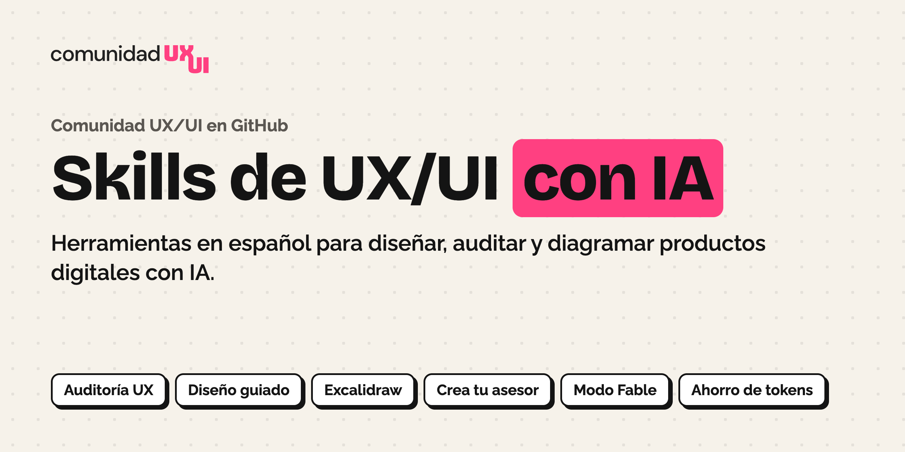
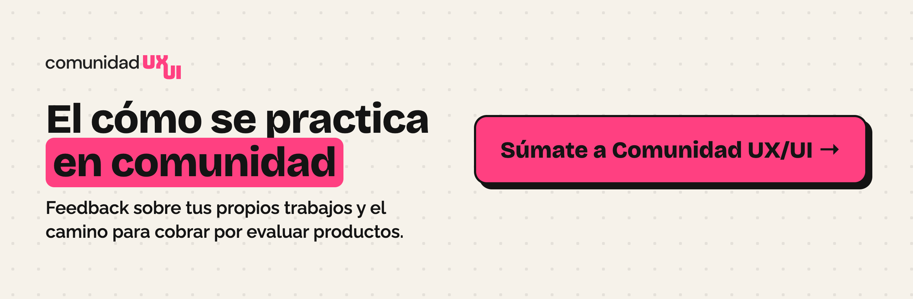

### Hola, somos Comunidad UX/UI 👋

Una comunidad de personas que diseñan productos digitales, en español. Aquí publicamos las skills que usamos todos los días para diseñar, auditar y diagramar con IA, cada una con su método, su documentación y lista para instalar en Claude, Claude Code, Cowork y otros agentes.

**Las compartimos de a una en nuestras redes:** síguenos en [Instagram](https://www.instagram.com/comunidaduxui/) para conseguir la próxima.

